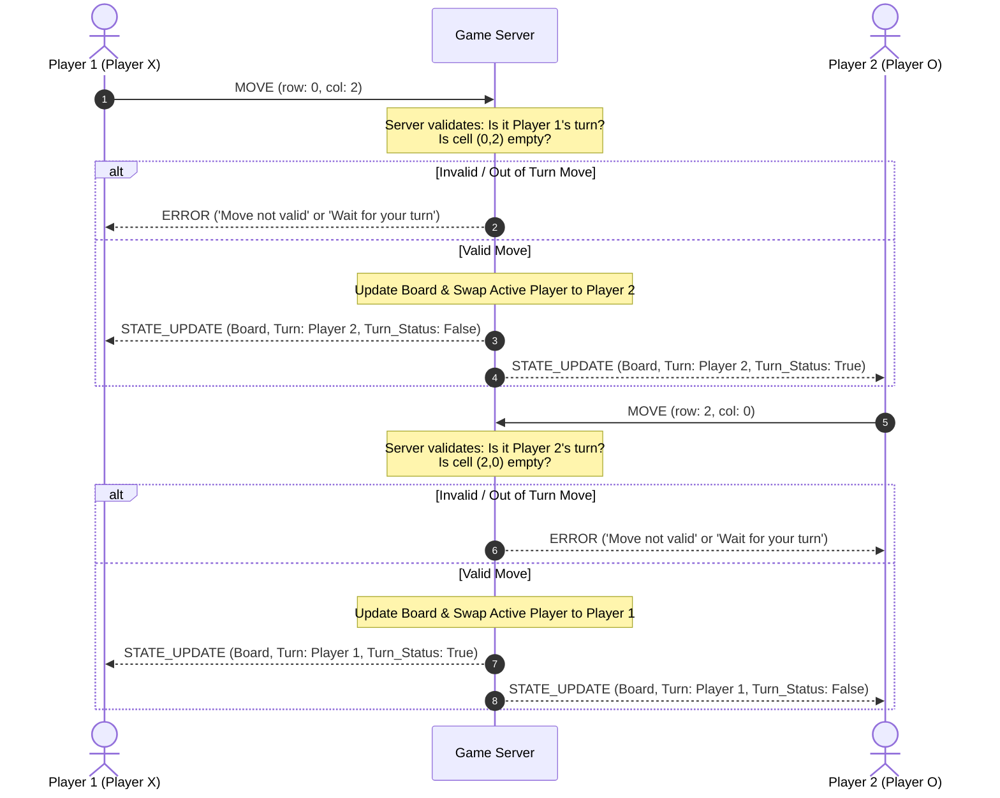

## State & Score Synchronization Across Clients
### **Turn Enforcement:**
- Each player will contain a unique ID assigned by the server itself instead of the user, to identify the first and second player (ex. player1) instead of by name.
  The server will keep track of which ID is active at the moment. The active player will make their move, and then send their ID alongside their move to the server. The server will then compare the ID sent by the player with the ID it is currently tracking (if curr_player_id == player.player_id).
  If true, then the server will validate the move (if validateselection(row, col)). If successful, the server will record the move, and then switch to the next player.
### **Score & Board Synchronization:**
- Neither clients will contain the actual board, the server will. The server will hold the most up to date board and after each time a move has been made, it will display the board to all players when loading the json with json.loads() in a STATE_UPDATE each times.
  Since this game will utilize the JSON framing structure, the data will come as a JSON string. 
### Turn Diagram:

