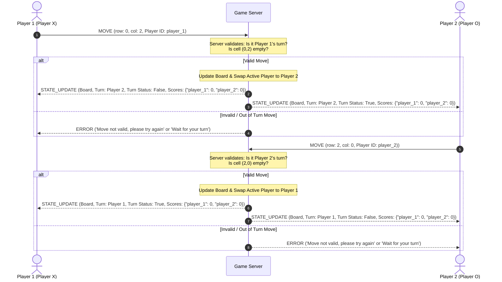

## State & Score Synchronization Across Clients
### **Turn Enforcement:**
- Each player will contain a unique ID assigned by the server itself instead of the user, to identify the first and second player (ex. player1) instead of by name.
  The server will keep track of which ID is active at the moment. The active player will make their move, and then send their ID alongside their move to the server. The server will then compare the ID sent by the player with the ID it is currently tracking (if curr_player_id == player.player_id).
  If true, then the server will validate the move (if validateselection(row, col)). If successful, the server will record the move, and then switch to the next player.
### **Score & Board Synchronization:**
- The server will hold the most up to date board and after each time a move has been made, it will display the board to all players when loading the Json with json.loads() in a STATE_UPDATE each times. Just like updating the board, it will also swap in the next player to make their move after the previous player, and it will also be sent with the updated board. Since this game will utilize the JSON framing structure, the data will come as a JSON string. as soon as they received a STATE_UPDATE from the server, their boards will be updated to the most recent updated board made by the server. The server will also keep track of scores of both clients connected to the server. When a client wins a game, their scores will be tallied up and the server will send a STATE_UPDATE at the round over screen, showing the current scores of both players and who has the most. It will keep doing that in each round when it ends. These are the ways that the server will make sure clients will stay synchronized with one another.
### Turn Diagram:

